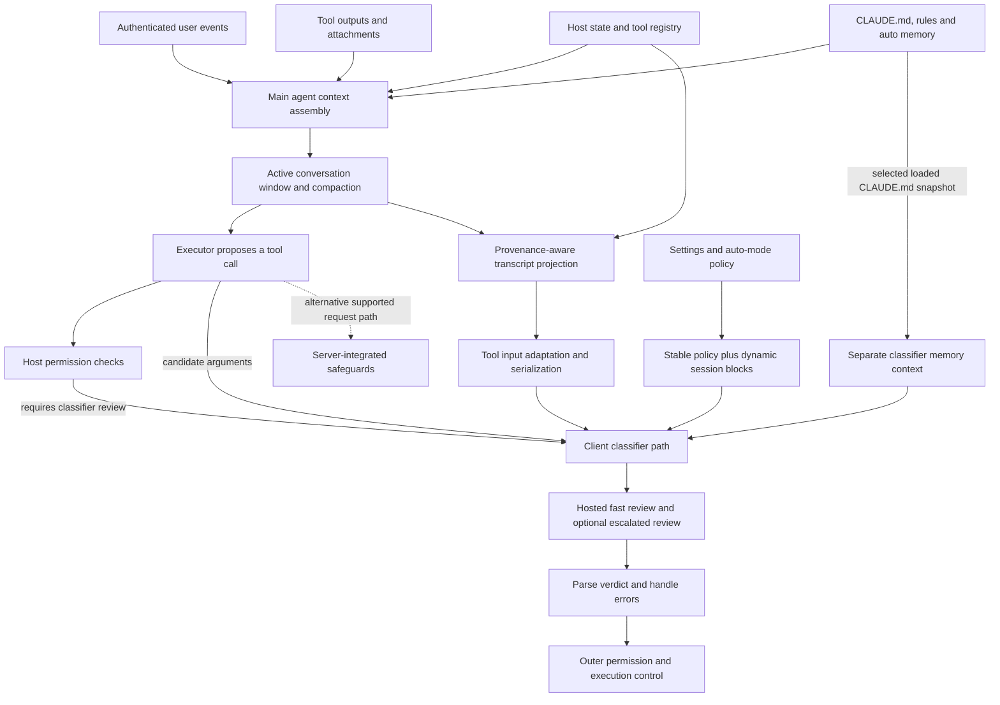

# Context, memory, and the path into tool-call policy

This is a map of the **Claude Code 2.1.323 client**, accompanied by an original,
executable reference implementation. It describes the recoverable client pipeline;
it does not expose hosted model weights or server-side internals. All symbol names
and offsets are version-specific. Start with the flow below, then use the detailed
pages to inspect each boundary.

| Read | Contents |
| --- | --- |
| [Transcript projection](projection.md) | Which events become classifier input, which disappear, provenance, answers, tool adapters, serialization |
| [Memory and compaction](memory.md) | Persistent files, active context, summaries, retention, budgets, classifier memory selection |
| [Request assembly](request-assembly.md) | Candidate tool call, stable policy, dynamic session facts, cache boundaries, review stages and failures |
| [Other context consumers](boundaries.md) | Server safeguards, ToolSearch, advisor, and what remains private |
| [Executable reference](reference.md) | Normalized host input, packet builder, audit output, explicit deviations and examples |
| [Reproduction](reproduction.md) | Artifact hashes, REA extraction, source navigation and read-only evidence verification |
| [Evidence manifest](evidence.json) | Machine-readable module hashes, byte offsets and short declaration anchors |

## The recovered architecture



This is a conceptual dataflow, not a claim that every configuration traverses
every box. Host policy can resolve a call without classifier review. Server
safeguards are a distinct path. Policy construction and context construction also
have separate inputs: there is no single universal operation that first extracts
all context and then passes it to one policy function.

For the inspected client-requested path, `bHe` coordinates classifier context and
candidate preparation. `byt` builds a filtered view of the active conversation;
`ozn` adapts tool inputs; `rzn` serializes entries; `_Zr` packages selected loaded
memory; `bZr` constructs policy blocks. The review chain continues through `BZr`,
`YGn`, `Yht`, `g1`, and `zQr` to the provider's Messages API. The detailed pages
describe switches and exceptions that this high-level diagram omits.

## Five different meanings of context

| State | Purpose | Boundary that matters |
| --- | --- | --- |
| Main agent conversation | Solve the task using messages, tools and attachments | Richer than the permission classifier's transcript |
| Persistent memory | Supply instructions or reusable information across turns/sessions | A file's presence is not fresh user authorization |
| Active window and summaries | Fit retained task state into the executor context | A generated summary is not a verbatim human message |
| Classifier projection | Judge the proposed action against intent and policy | Provenance and tool-specific filtering determine what survives |
| Prompt/schema caches | Reuse stable input or tool definitions efficiently | Cache hits do not create permission or prove current state |

The practical finding is that reducing this pipeline to “last N messages” loses
meaning. Ordinary tool-result text, direct human requests, authenticated relay
messages, question answers and generated summaries receive different treatment.
Even assistant prose has configuration-dependent handling. A faithful model input
design needs those distinctions before training begins.

## What the code implements

[`context.build_packet`](../../src/small_auto_mode/context.py) accepts an explicit
host-owned event format and returns separate policy/context blocks, the exact
candidate call, input digests, and an audit of projection decisions. It performs
no tool execution, filesystem memory discovery, inference or summarization. The
host must authenticate event origins before constructing this input.

```sh
small-auto-mode context-build --input examples/context-input.json
```

A ready packet has `decision: "unassessed"`. Incomplete or unsupported input
returns `ask`. Read [the reference contract](reference.md) before integrating it:
its byte budget, attestations and conservative rejection rules are independent
design choices, not recovered native algorithms. It is not automatically wired
into the existing classifier or training input format.

## Evidence and remaining work

**Recovered:** embedded client code, control flow, data-selection rules, request
assembly, parsers and local search orchestration. The evidence manifest pins the
binary and the declaration locations used in this map.

**Implemented independently:** a readable subset of context projection and packet
assembly, with boundary tests and a repeatable artifact verifier. The tests check
our contract; they do not establish byte-for-byte Claude parity.

**Not completed:** live capture of proprietary classifier requests/verdicts, a
reviewed representative dataset, training the 596M classifier, or measuring its
accuracy on tool authorization. The previous random-Transformer smoke test only
established that the training/save/load plumbing works. This context work prepares
an auditable input contract for that later experiment.

To connect this work to training, first choose and version the context format,
build a trusted host adapter, collect owned or otherwise permitted examples, and
review labels with the original intent and constraints available. Split by session
and scenario before fitting the classifier. Measure unsafe approvals against
coverage on held-out cases, including stale memory, summary omissions, forged
user answers, prompt injection in tool results, and missing context.
